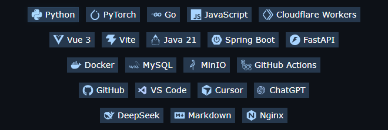
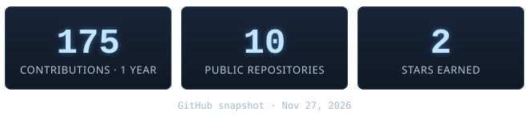

**[ENTER →](https://yuan-27.github.io/winter-profile/)**

  

<h3 align="center">TECH STACK</h3>

  

  <a href="https://github.com/YUAN-27/Transformer-on-Metax-V1">Python</a> · <a href="https://github.com/YUAN-27/Transformer-on-Metax-V1">PyTorch</a> · <a href="https://github.com/YUAN-27/GolangTraining">Go</a> · <a href="https://github.com/YUAN-27/winter-profile">JavaScript</a> · <a href="https://github.com/YUAN-27/winter-profile/tree/main/counter">Cloudflare Workers</a>

<h3 align="center">SELECTED PROJECTS</h3>

  <strong><a href="https://github.com/YUAN-27/proof_flow">proof_flow</a></strong> 
  Organizes evidence for after-sales disputes and prepares investigation reports for human review.

<h4 align="center">Coding Stats</h4>

  

<h3 align="center">CONTRIBUTION ACTIVITY</h3>

  

