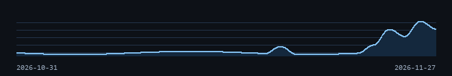

**[ENTER →](https://yuan-27.github.io/winter-profile/)**

  

<h3 align="center">TECH STACK</h3>

  

  <a href="https://github.com/YUAN-27/Transformer-on-Metax-V1">Python</a> · <a href="https://github.com/YUAN-27/Transformer-on-Metax-V1">PyTorch</a> · <a href="https://github.com/YUAN-27/GolangTraining">Go</a> · <a href="https://github.com/YUAN-27/winter-profile">JavaScript</a> · <a href="https://github.com/YUAN-27/winter-profile/tree/main/counter">Cloudflare Workers</a>

### SELECTED PROJECTS

- **[Transformer-on-Metax-V1](https://github.com/YUAN-27/Transformer-on-Metax-V1)** — A PyTorch implementation of the original encoder–decoder Transformer for English–Chinese translation.
- **[Winter Profile](https://github.com/YUAN-27/winter-profile)** — An interactive snow scene with typed dialogue, built with HTML, CSS, and JavaScript. [Open the site](https://yuan-27.github.io/winter-profile/)

<h3 align="center">CONTRIBUTION ACTIVITY</h3>

  

